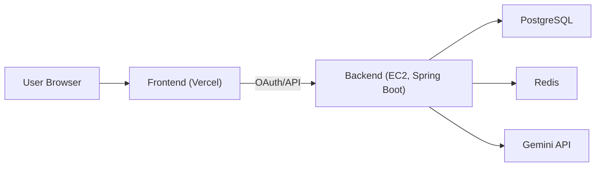

# Compass

> AI 기반 여행 일정 생성/관리 웹 서비스

[](#)
[](#)
[](#)
[](#)

## 프로젝트 소개
Compass는 **여행지/기간/스타일**을 입력하면 AI가 실사용 가능한 일정 초안을 생성하고,
사용자가 저장/조회/수정 흐름으로 이어갈 수 있게 만든 여행 플래너입니다.

- 프론트: React + Vite
- 백엔드: Spring Boot + OAuth2 + JWT
- 인프라: Vercel + EC2(Docker Compose) + Caddy

## 라이브 서비스
- 프론트엔드: [https://www.compass-travel.site](https://www.compass-travel.site)
- 백엔드 API: [https://api.compass-travel.site](https://api.compass-travel.site)

## 핵심 기능
- Google OAuth 로그인 및 JWT 인증
- AI 여행 일정 생성 (`/api/agent/plan`)
- 채팅 세션/메시지 이력 관리 (`/api/chat/sessions`)
- 내 일정 목록/상세/삭제 (`/api/plans`)
- Google Maps 기반 장소/동선 시각화

## 기술 스택
| 영역 | 기술 |
| --- | --- |
| Frontend | React 19, Vite 8, React Router, Tailwind CSS v4 |
| Backend | Java 17, Spring Boot 3.4, Spring Security, OAuth2, JWT, JPA, Querydsl, Spring AI |
| Data | PostgreSQL(+pgvector), Redis |
| Infra | Docker Compose, Caddy, AWS EC2, Vercel |

## 아키텍처


## 프로젝트 구조
```text
KHS-BE/
├─ backend/                 # Spring Boot API
├─ compass-frontend/        # React + Vite
├─ docs/                    # 프로젝트 문서
├─ docker-compose.yml       # 로컬(Postgres/Redis)
├─ docker-compose.prod.yml  # 운영(EC2)
└─ Caddyfile                # Reverse Proxy / TLS
```

## 빠른 시작 (로컬 실행)
자세한 버전/환경은 [개발자 실행 가이드](./docs/개발자_실행가이드.md)를 참고하세요.

### 1) 저장소 클론
```bash
git clone https://github.com/KHSBE/KHSBE-AIT.git
cd KHS-BE
```

### 2) 인프라 실행 (PostgreSQL, Redis)
```bash
docker compose up -d
```

### 3) 백엔드 실행
```bash
cd backend
./gradlew bootRun
```

Windows:
```powershell
cd backend
.\gradlew.bat bootRun
```

### 4) 프론트 실행
```bash
cd compass-frontend
npm install
npm run dev
```

접속: `http://localhost:5173`

## 환경 변수
### Backend (`/backend` 실행 시 필요)
- `DB_HOST`, `DB_PORT`, `DB_NAME`, `DB_USERNAME`, `DB_PASSWORD`
- `REDIS_HOST`, `REDIS_PORT`
- `GOOGLE_CLIENT_ID`, `GOOGLE_CLIENT_SECRET`
- `GOOGLE_AI_STUDIO_API_KEY`
- `JWT_SECRET`
- `WEATHER_API_KEY`
- `CORS_ALLOWED_ORIGINS`
- `OAUTH2_REDIRECT_URI`

### Frontend (`/compass-frontend/.env`)
- `VITE_API_BASE_URL`
- `VITE_GOOGLE_MAPS_API_KEY`

## 주요 API
- `GET /api/agent/chat`
- `POST /api/agent/plan`
- `GET /api/chat/sessions`
- `GET /api/chat/sessions/{sessionId}/messages`
- `DELETE /api/chat/sessions/{sessionId}`
- `GET /api/plans`
- `GET /api/plans/{planId}`
- `DELETE /api/plans/{planId}`
- `GET /api/user/me`
- `POST /api/user/preference`
- `POST /api/auth/refresh`

## 문서
- [문서 인덱스](./docs/README.md)
- [개발자 실행 가이드](./docs/개발자_실행가이드.md)
- [아키텍처](./docs/아키텍처.md)
- [ERD](./docs/erd.md)
- [서버 운영 런북](./docs/서버_운영_런북.md)

## 라이선스
`LICENSE` 파일을 참고하세요.
