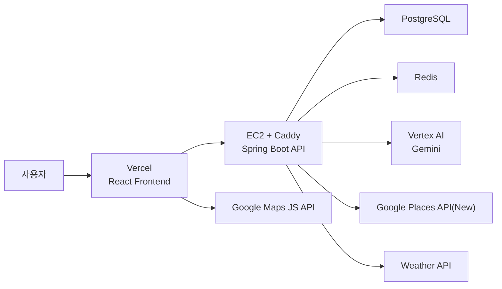

# Compass

AI가 여행 조건을 이해하고, 장소 검증까지 거쳐 여행 일정을 만들어주는 웹 서비스입니다.

단순 채팅봇이 아니라 `여행 의도 감지 -> 입력 폼 -> 일정 생성 -> 장소 검증 -> 저장/수정/조회` 흐름으로 동작하도록 설계했습니다.

## 배포 링크

- 서비스: https://www.compass-travel.site
- API: https://api.compass-travel.site

## 주요 기능

| 구분 | 설명 |
| --- | --- |
| Google OAuth 로그인 | Google 계정으로 가입/로그인, JWT Access/Refresh 토큰 발급 |
| AI 여행 플래너 | 일반 채팅과 일정 생성 의도를 분리하고, 일정 생성에는 상위 Gemini 모델 사용 |
| 일정 품질 검사 | 생성 결과의 날짜 수, 장소 수, 좌표, 필수 필드를 검사하고 실패 시 쿼터를 복구 |
| Places 검증 | Google Places API(New)로 장소명, 좌표, Place ID, 신뢰도, 대체 후보를 검증 |
| 일정 관리 | 내 일정 목록/상세 조회, 일정 삭제, 장소 교체, 장소 상세 모달 제공 |
| 지도 연동 | Google Maps 기반 일정 경로 표시, 장소 클릭, Google 길찾기 딥링크 제공 |
| 사용량 제한 | 사용자별 일일 일정 생성/채팅 쿼터 제공 |
| 관리자 페이지 | 관리자 계정이 사용자 검색, 쿼터 조회/수정/초기화 가능 |
| 배포 구성 | Vercel 프론트엔드, EC2 Docker Compose 백엔드, Caddy HTTPS 리버스 프록시 |
| CI | GitHub Actions로 백엔드 테스트와 프론트엔드 lint/build 검증 |

## 기술 스택

| 영역 | 기술 |
| --- | --- |
| Frontend | React, Vite, JavaScript, Google Maps JavaScript API |
| Backend | Java 17, Spring Boot 3, Spring Security, Spring Data JPA |
| AI | Spring AI, Google GenAI Vertex AI, Gemini |
| Database | PostgreSQL |
| Cache/Session | Redis |
| Infra | AWS EC2, Docker Compose, Caddy, Vercel |
| CI | GitHub Actions |

## 아키텍처



## 프로젝트 구조

```text
.
├─ backend/                 # Spring Boot API 서버
├─ compass-frontend/        # React/Vite 프론트엔드
├─ docs/                    # 개발/배포/설계 문서
├─ docker-compose.prod.yml  # EC2 운영용 Docker Compose
├─ Caddyfile                # API 도메인 HTTPS 리버스 프록시
└─ .github/workflows/ci.yml # CI 파이프라인
```

## 로컬 실행

### 1. 백엔드 환경변수

`backend/.env` 또는 실행 환경에 아래 값을 준비합니다.

```env
DB_HOST=localhost
DB_PORT=5432
DB_NAME=compass
DB_USERNAME=compass_user
DB_PASSWORD=compass_password

REDIS_HOST=localhost
REDIS_PORT=6379

GOOGLE_CLIENT_ID=...
GOOGLE_CLIENT_SECRET=...
OAUTH2_REDIRECT_URI=http://localhost:5173/oauth2/redirect
CORS_ALLOWED_ORIGINS=http://localhost:5173,http://127.0.0.1:5173

GOOGLE_GENAI_VERTEX_AI=true
GOOGLE_PROJECT_ID=...
GOOGLE_CLOUD_LOCATION=global
GOOGLE_CREDENTIALS_URI=file:../secrets/gcp-sa.json
AI_MODEL_GENERAL=gemini-3.1-flash-lite-preview
AI_MODEL_PLAN=gemini-3.1-pro-preview

GOOGLE_PLACES_API_KEY=...
GOOGLE_PLACES_LANGUAGE=ko
WEATHER_API_KEY=...
JWT_SECRET=...
ADMIN_EMAILS=admin@example.com

PLAN_QUOTA_PER_DAY=3
CHAT_QUOTA_PER_DAY=10
```

### 2. 백엔드 실행

```bash
cd backend
./gradlew bootRun
```

### 3. 프론트엔드 환경변수

`compass-frontend/.env`를 준비합니다.

```env
VITE_API_BASE_URL=http://localhost:8080
VITE_GOOGLE_MAPS_API_KEY=...
```

### 4. 프론트엔드 실행

```bash
cd compass-frontend
npm install
npm run dev
```

## 주요 API

| Method | Path | 설명 |
| --- | --- | --- |
| `POST` | `/api/auth/refresh` | Access Token 재발급 |
| `POST` | `/api/agent/chat` | 일반 채팅, 일정 생성 의도 감지 |
| `POST` | `/api/agent/plan` | 여행 일정 생성 |
| `GET` | `/api/agent/quota` | 내 일일 사용량 조회 |
| `GET` | `/api/chat/sessions` | 채팅 세션 목록 |
| `GET` | `/api/chat/sessions/{sessionId}/messages` | 채팅 메시지 조회 |
| `DELETE` | `/api/chat/sessions/{sessionId}` | 채팅 세션 삭제 |
| `GET` | `/api/plans` | 내 일정 목록 |
| `GET` | `/api/plans/{planId}` | 일정 상세 |
| `DELETE` | `/api/plans/{planId}` | 일정 삭제 |
| `PUT` | `/api/plans/{planId}/itineraries/{itineraryId}/places` | 장소 목록 수정 |
| `GET` | `/api/admin/users` | 관리자 사용자 검색 |
| `GET` | `/api/admin/users/{userId}/quota` | 관리자 쿼터 조회 |
| `PUT` | `/api/admin/users/{userId}/quota` | 관리자 쿼터 수정 |
| `DELETE` | `/api/admin/users/{userId}/quota` | 관리자 쿼터 기본값 초기화 |

## 검증 명령

```bash
cd backend
./gradlew test
```

```bash
cd compass-frontend
npm run lint
npm run build
```

## 문서

- [개발자 실행 가이드](docs/개발자_실행가이드.md)
- [서버 운영 런북](docs/서버_운영_런북.md)
- [아키텍처](docs/아키텍처.md)
- [ERD](docs/erd.md)

## 현재 개선 예정

- DB 스키마 변경 이력을 Flyway로 관리
- Google Maps JavaScript의 legacy Places/Marker 사용부를 최신 API로 교체
- 일정 상세 페이지 컴포넌트 분리와 테스트 보강
- 공유 링크, PDF 다운로드, 비용 계산 기능 추가
