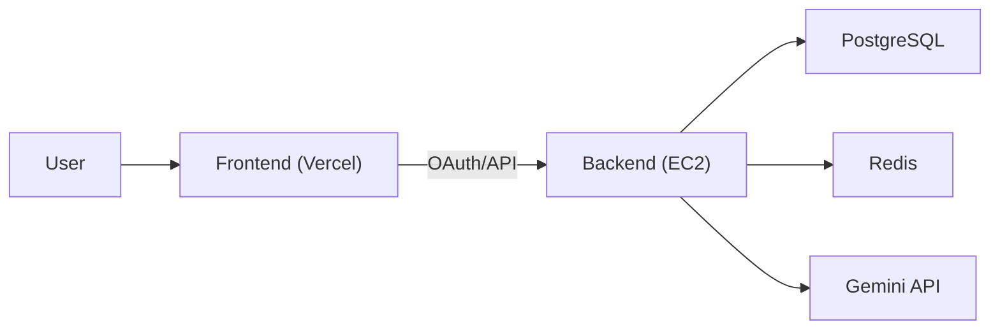

# Compass

AI travel planner web app.  
Users sign in with Google OAuth, enter trip info, and generate/save itinerary plans with an AI agent.

## Live
- Frontend: `https://www.compass-travel.site`
- Backend API: `https://api.compass-travel.site`

## Core Features
- Google OAuth login + JWT/Refresh token auth
- AI itinerary generation (`POST /api/agent/plan`)
- Chat sessions/messages (`/api/chat/sessions`)
- My plans list/detail/delete (`/api/plans`)
- Map visualization (Google Maps Marker/Polyline)

## Tech Stack
| Layer | Stack |
| --- | --- |
| Frontend | React 19, Vite 8, React Router, Tailwind CSS v4 |
| Backend | Java 17, Spring Boot 3.4, Spring Security, OAuth2, JWT, JPA, Querydsl, Spring AI |
| Data | PostgreSQL (+ pgvector), Redis |
| Infra | Docker Compose, Caddy, AWS EC2, Vercel |

## Architecture


## API Scope
- `GET /api/agent/chat`
- `POST /api/agent/plan`
- `GET /api/chat/sessions`
- `GET /api/chat/sessions/{sessionId}/messages`
- `DELETE /api/chat/sessions/{sessionId}`
- `GET /api/plans`
- `GET /api/plans/{planId}`
- `DELETE /api/plans/{planId}`
- `GET /api/user/me`
- `POST /api/user/preference`
- `POST /api/auth/refresh`

## Project Structure
```text
KHS-BE/
├─ backend/                    # Spring Boot API
├─ compass-frontend/           # React + Vite
├─ docs/                       # project docs
├─ docker-compose.yml          # local DB/Redis
├─ docker-compose.prod.yml     # production deployment
└─ Caddyfile                   # reverse proxy
```

## Local Setup
### 1) Infra
```bash
docker compose up -d
```

### 2) Backend
```bash
cd backend
./gradlew bootRun
```
Windows:
```powershell
cd backend
.\gradlew.bat bootRun
```

### 3) Frontend
```bash
cd compass-frontend
npm install
npm run dev
```

## Environment Variables
Backend root `.env`:
- `DB_HOST`, `DB_PORT`, `DB_NAME`, `DB_USERNAME`, `DB_PASSWORD`
- `REDIS_HOST`, `REDIS_PORT`
- `GOOGLE_CLIENT_ID`, `GOOGLE_CLIENT_SECRET`
- `GOOGLE_AI_STUDIO_API_KEY`
- `JWT_SECRET`
- `WEATHER_API_KEY`
- `CORS_ALLOWED_ORIGINS`
- `OAUTH2_REDIRECT_URI`

Frontend `compass-frontend/.env`:
- `VITE_API_BASE_URL`
- `VITE_GOOGLE_MAPS_API_KEY`

## Docs
- [Docs Index](/C:/Users/momki/Desktop/KHS-BE/docs/README.md)
- [Architecture](/C:/Users/momki/Desktop/KHS-BE/docs/아키텍처.md)
- [ERD](/C:/Users/momki/Desktop/KHS-BE/docs/erd.md)
- [Server Runbook](/C:/Users/momki/Desktop/KHS-BE/docs/서버_운영_런북.md)

## License
See `LICENSE`.

