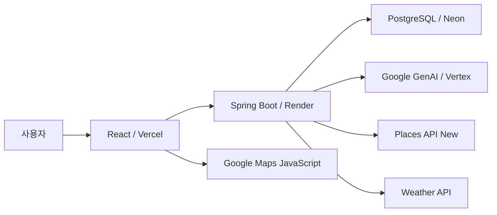

# Compass

여행 조건을 입력받아 AI 일정 초안을 생성하고, Google Places 검색 결과와 매칭해 저장·편집하는 여행 플래너입니다.
`일반 채팅 → 여행 의도 감지 → 입력 폼 → 생성 → 품질 검사 → 장소/숙소 매칭 → 저장` 흐름을 구현했습니다.

## 서비스와 배포 상태

- [프론트](https://www.compass-travel.site) / [Vercel 기본 주소](https://khsbe-ait.vercel.app)
- [백엔드](https://khsbe-ait.onrender.com) (API 서버이며 사용자용 홈페이지가 아닙니다.)
- 2026-11-05: Render Live, Vercel Production 배포 및 새 API 주소 반영 확인.
- 로그인 완료·AI 생성·DB 저장까지의 통합 검증과 알려진 결함 수정은 별도 진행 중입니다.
- 무료 서버는 휴면 후 기동 지연이 있을 수 있습니다. AI/지도 API와 도메인 비용은 호스팅과 별개입니다.

## 기능과 기술

| 영역 | 구현 |
| --- | --- |
| Frontend | React, Vite, Google Maps JavaScript API |
| Backend | Java 17, Spring Boot, Security, JPA |
| 인증 | Google OAuth2, 타입이 구분된 JWT Access/Refresh |
| AI | Spring AI + Google GenAI(Vertex), 일반 채팅/일정 생성 모델 분리 |
| 품질 검사 | 날짜·일차 수·장소 수·필수 텍스트·일차 내 장소명 중복 검사 |
| Places | Places API(New) 후보 검색, 점수 매칭, 좌표/Place ID/검증 메타데이터 저장 |
| 일정 | 조회·편집·삭제, 장소 상세, 지도와 Google 길찾기 연결 |
| 운영 | 사용자별 일일 쿼터, 관리자 조회/설정/초기화 |
| 데이터 | Neon PostgreSQL, Places 검색은 프로세스 내 메모리 캐시 |
| 배포 | Vercel 프론트 + Render Docker 백엔드 |
| CI | GitHub Actions 백엔드 테스트 + 프론트 lint/build |

장소 매칭은 방문일 영업 여부나 전체 동선의 실행 가능성을 보장하지 않습니다.
매칭 점수는 통계적 정확도 확률이 아닙니다. Redis 의존성은 남아 있지만 Render에서는 사용하지 않습니다.

## 구조



```text
backend/                         Spring Boot API
backend/Dockerfile.render        현재 Render 이미지
compass-frontend/                React/Vite 프론트
.github/workflows/ci.yml         자동 검사
docs/RENDER_DEPLOYMENT.md         배포 설정의 기준 문서
docs/archive/                    과거 EC2 운영 기록
docs/prototypes/                 운영에 미반영된 디자인 시안
docker-compose.yml              선택적 로컬 DB/Redis
docker-compose.prod.yml         과거 EC2 구성 (현재 배포에 사용하지 않음)
Caddyfile                        과거 EC2 HTTPS 설정
```

## 시작하기

- 배포부터: [Render·Neon·Vercel 배포 가이드](docs/RENDER_DEPLOYMENT.md)
- 로컬 실행/테스트: [개발자 실행 가이드](docs/개발자_실행가이드.md)
- 장애 확인: [서버 운영 런북](docs/서버_운영_런북.md)
- 설계: [아키텍처](docs/아키텍처.md), [ERD](docs/erd.md)
- 전체 문서: [문서 인덱스](docs/README.md)

환경변수 목록은 배포/로컬 가이드에서 관리합니다. 비밀 파일은 저장소에 포함하지 않습니다.

## 주요 API

| Method | Path | 설명 |
| --- | --- | --- |
| `POST` | `/api/auth/refresh` | Access Token 재발급 |
| `POST` | `/api/agent/chat` | 일반 채팅, 일정 생성 의도 감지 |
| `POST` | `/api/agent/plan` | 여행 일정 생성 |
| `GET` | `/api/agent/quota` | 내 일일 사용량 조회 |
| `GET` | `/api/chat/sessions` | 채팅 세션 목록 |
| `GET` | `/api/chat/sessions/{sessionId}/messages` | 채팅 메시지 조회 |
| `DELETE` | `/api/chat/sessions/{sessionId}` | 채팅 세션 삭제 |
| `GET` | `/api/plans` | 내 일정 목록 |
| `GET` | `/api/plans/{planId}` | 일정 상세 |
| `DELETE` | `/api/plans/{planId}` | 일정 삭제 |
| `PUT` | `/api/plans/{planId}/itineraries/{itineraryId}/places` | 장소 목록 수정 |
| `GET` | `/api/admin/users` | 관리자 사용자 검색 |
| `GET` | `/api/admin/users/{userId}/quota` | 관리자 쿼터 조회 |
| `PUT` | `/api/admin/users/{userId}/quota` | 관리자 쿼터 수정 |
| `DELETE` | `/api/admin/users/{userId}/quota` | 관리자 쿼터 기본값 초기화 |

## 현재 개선 대상

- 독립적인 사용량 기록과 원자적 쿼터 처리.
- Refresh Token 전달/보관/회전/폐기 개선.
- 장소 지역 불일치 차단과 Places 매칭 후 품질 검사.
- 미검증/확인 필요 상태를 과장하지 않는 UI.
- 일정 전체 편집의 원자성 및 채팅 삭제 트랜잭션.
- 외부 API 호출과 DB 트랜잭션 분리, 검색 횟수 최적화.
- DB 마이그레이션, 통합 테스트와 모바일 UX 검증.

배포 성공과 서비스 기능 검증 완료를 구분합니다. 최신 구현 제약은 [아키텍처](docs/아키텍처.md)를 참고하세요.
