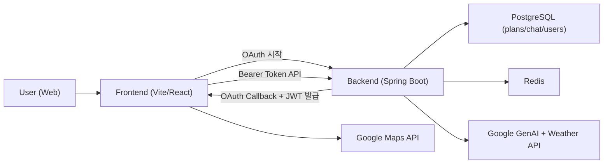

# Compass

[](./backend)
[](./compass-frontend)
[](./docker-compose.yml)
[](./docker-compose.yml)

AI 기반 개인화 여행 플래너입니다.  
Google OAuth 로그인 후, 대화형으로 여행 요청을 입력하면 AI가 일정(JSON)을 생성하고 DB에 저장합니다.

---

## 주요 기능

- Google OAuth 로그인 + JWT/Refresh Token 인증
- AI 대화형 여행 일정 생성 (`PLAN_CREATION` 의도 분류)
- 채팅 세션/메시지 저장 및 이력 조회
- 마이페이지에서 내 여행 일정 목록/상세 조회
- 일정 상세 지도 시각화 (Google Maps Marker/Polyline)
- 만료 토큰 자동 재발급 (`/api/auth/refresh`)

---

## 기술 스택

### Backend
- Java 17
- Spring Boot 3.4.1
- Spring Security, OAuth2 Client, JWT
- Spring Data JPA, Querydsl
- Spring AI (Google GenAI)
- PostgreSQL, Redis

### Frontend
- React 19 + Vite 8
- React Router
- Tailwind CSS v4
- Google Maps JS API

### Infra
- Docker / Docker Compose
- pgvector (ankane/pgvector)

---

## 아키텍처



---

## 로컬 실행

### 1) 사전 준비
- Java 17
- Node.js 20+
- Docker Desktop

### 2) 인프라 실행
```bash
docker compose up -d
```

### 3) Backend 실행
```bash
cd backend
./gradlew bootRun
```
Windows:
```powershell
cd backend
.\gradlew.bat bootRun
```

### 4) Frontend 실행
```bash
cd compass-frontend
npm install
npm run dev
```

### 5) 접속 주소
- Frontend: `http://localhost:5173`
- Backend: `http://localhost:8080`
- PostgreSQL: `localhost:5433`
- Redis: `localhost:6379`

---

## 환경변수

### 루트 `.env` (Backend용)

필수 키:

- `DB_HOST`, `DB_PORT`, `DB_NAME`, `DB_USERNAME`, `DB_PASSWORD`
- `GOOGLE_CLIENT_ID`, `GOOGLE_CLIENT_SECRET`
- `GOOGLE_AI_STUDIO_API_KEY`
- `JWT_SECRET`
- `WEATHER_API_KEY`
- `CORS_ALLOWED_ORIGINS`
- `OAUTH2_REDIRECT_URI`

### `compass-frontend/.env`

- `VITE_API_BASE_URL`
- `VITE_GOOGLE_MAPS_API_KEY`

예시는 [compass-frontend/.env.example](./compass-frontend/.env.example) 참고.

---

## 프로젝트 구조

```text
KHS-BE/
├─ backend/                    # Spring Boot API
│  └─ src/main/java/com/compass
│     ├─ domain/agent|plan|user
│     └─ global/config|common|error
├─ compass-frontend/           # React + Vite Web
│  └─ src/pages|utils
├─ docs/                       # 설계/배포 문서
└─ docker-compose.yml          # 로컬 DB/Redis
```

---

## 배포 가이드

가성비형 배포 절차는 아래 문서 참고:

- [docs/가성비_배포_실행가이드.md](./docs/가성비_배포_실행가이드.md)

---

## 라이선스

See [LICENSE](./LICENSE).
