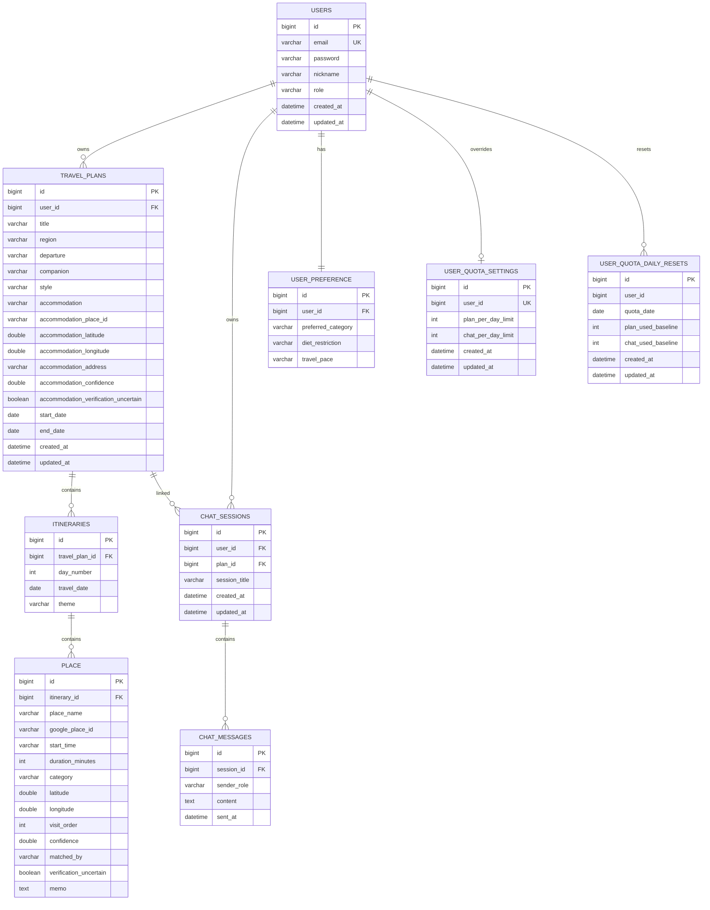

# ERD

현재 JPA 엔티티 기준의 주요 테이블 구조입니다.

## 핵심 설계 메모

- `users.role`은 `USER`, `ADMIN` 값을 가지며 관리자 페이지 접근 권한에 사용됩니다.
- `travel_plans.accommodation_*` 필드는 숙소도 장소처럼 검증하고 지도에 표시하기 위한 필드입니다.
- `place.confidence`, `place.matched_by`, `place.verification_uncertain`은 Places 검증 결과를 저장합니다.
- `user_quota_settings`는 사용자별 쿼터 override를 저장합니다.
- `user_quota_daily_resets`는 관리자가 당일 사용량을 기본값 기준으로 리필할 때 baseline을 저장합니다.

## 주의 사항

현재 프로젝트는 Hibernate DDL 자동 반영에 의존하는 부분이 있습니다. 운영 안정성을 높이려면 다음 단계로 Flyway를 도입해 스키마 변경 이력을 명시적으로 관리하는 것이 좋습니다.
