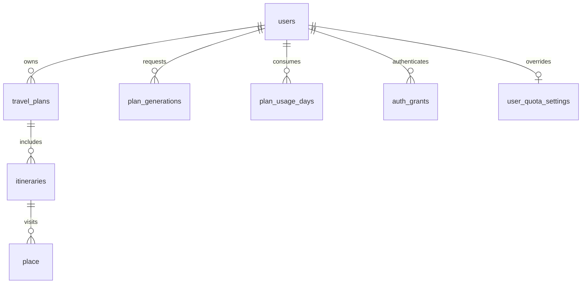

# 데이터 구조

사용자 ID 기반 인증/사용량 테이블의 관계 일부는 논리 관계이며 DB FK는 아닙니다.

| 테이블 | 주요 필드 / 불변 조건 |
| --- | --- |
| users | email, nickname, role |
| travel_plans | user_id, destination_place_id, generation_notes, title, region, dates, 선택 숙소 Place ID/좌표 |
| itineraries | travel_plan_id, day_number, travel_date, theme |
| place | itinerary_id, visit_order, google_place_id, name, coordinates, start_time, duration_minutes, category, memo, matched_by, source_uri, verification_uncertain |
| plan_generations | UNIQUE(user_id, request_id), fingerprint, status, attempt, expires_at, quota_date, plan_id |
| plan_usage_days | UNIQUE(user_id, quota_date), used; 일정 삭제와 독립 |
| auth_grants | token_hash PK, user_id, family_id, kind, expires_at, used; 원문 토큰 미저장 |
| user_quota_settings | 사용자별 일일 한도 override |
| user_quota_daily_resets | 과거 사용량 초기화 기준의 전환용 테이블 |

confidence 컬럼은 구버전 호환을 위해 남아 있지만 새 생성/수정 결과에는 확률을 넣지 않습니다.
채팅/사용자 선호 엔티티는 기존 데이터 보존용으로 남아 있으며 새 API에서 사용하지 않습니다.
Flyway V1은 신규 상태 테이블과 기존 일정/장소의 신규 컬럼을 다룹니다. 기존 스키마 전체 정의를 대체하지 않습니다.