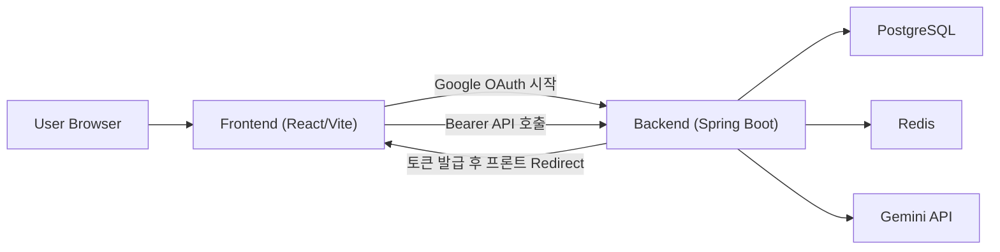

# Compass 아키텍처

## 1) 서비스 구성
- Frontend: Vercel (`https://www.compass-travel.site`)
- Backend API: EC2 + Docker Compose + Caddy (`https://api.compass-travel.site`)
- Database: PostgreSQL (컨테이너 `compass-db`)
- Cache: Redis (컨테이너 `compass-redis`)
- AI Model: `gemini-3.1-flash-lite-preview` (Spring AI)

## 2) 요청 흐름


## 3) 핵심 시나리오
### 로그인
1. 프론트에서 `/oauth2/authorization/google`로 이동
2. 구글 인증 후 백엔드 콜백(`/login/oauth2/code/google`)
3. 백엔드가 JWT/RefreshToken 생성
4. 프론트 Redirect URI(`.../oauth2/redirect`)로 토큰 전달

### 일정 생성
1. 사용자가 Planner 입력 폼 작성
2. 프론트에서 `/api/agent/plan` 호출
3. 백엔드 `TravelAgentService`가 AI로 일정 JSON 생성
4. `PlanCommandService`가 `travel_plans / itineraries / places` 저장
5. 프론트가 생성 결과 카드 + 일정 상세 조회

### 일정/대화 조회
- 채팅 세션: `/api/chat/sessions`
- 메시지 내역: `/api/chat/sessions/{sessionId}/messages`
- 일정 목록/상세: `/api/plans`, `/api/plans/{planId}`

## 4) 백엔드 모듈 구조
```text
domain/
  agent/   # AI 대화, 일정 생성, 세션/메시지
  plan/    # 일정 저장/조회/삭제
  user/    # OAuth 사용자/프로필/선호도
global/
  config/  # Security, OAuth2, JWT, CORS
  common/  # 공통 응답/엔티티
```

## 5) 현재 설계상 주의점
- 장소 정확도는 AI 출력 품질에 의존 (Places API 검증 레이어 미적용)
- `lat/lng` 누락 시 `0.0` 저장되므로 지도 표시에서 제외될 수 있음
- 운영 환경은 `.env` 값 반영 후 backend 재생성이 필요

