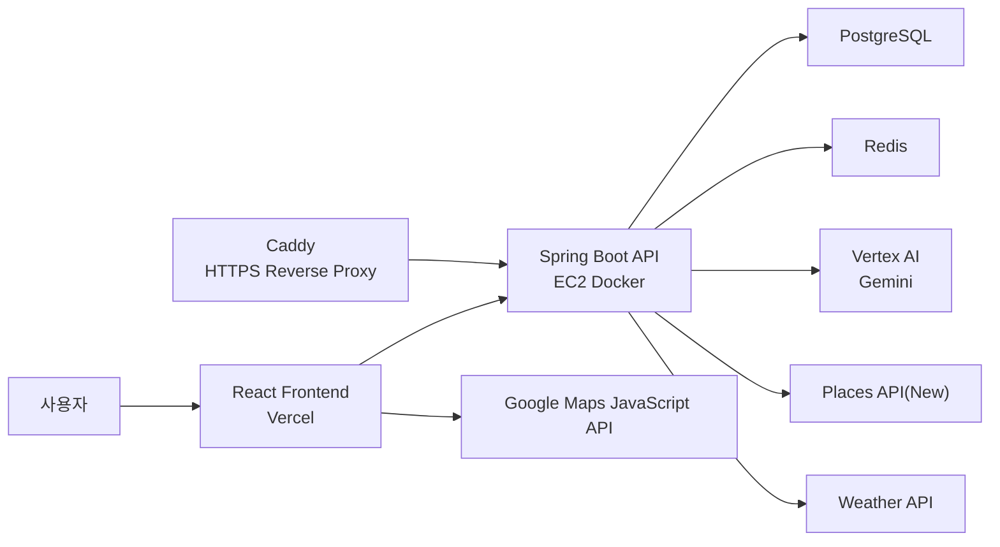
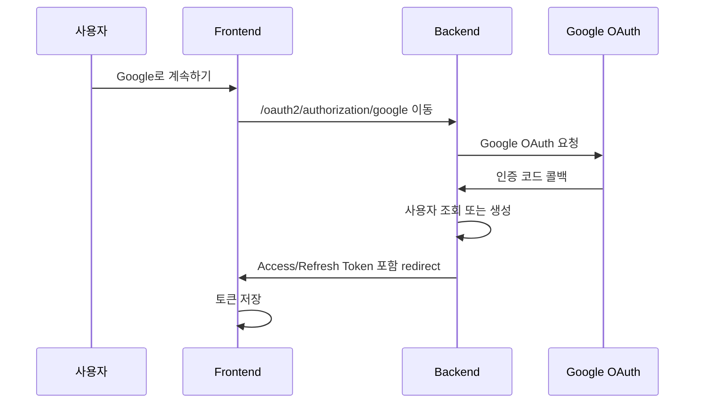
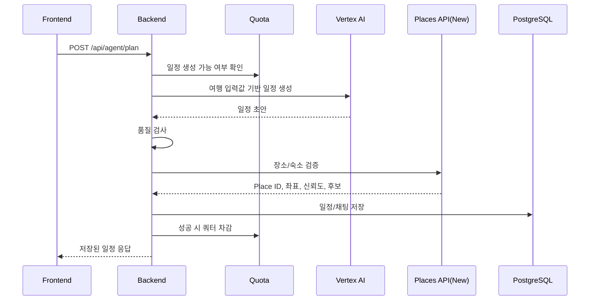
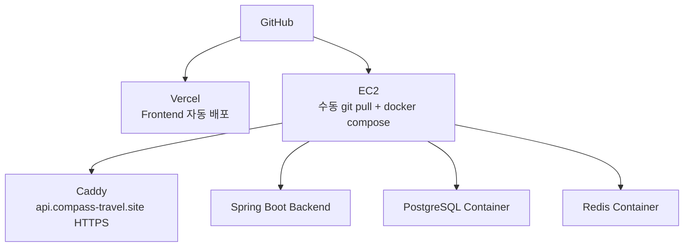

# Compass 아키텍처

## 전체 구조



## 백엔드 모듈

| 모듈 | 역할 |
| --- | --- |
| `global` | 공통 응답, 예외 처리, 보안 설정, JWT, OAuth2 |
| `user` | 사용자, 권한, 여행 취향 |
| `agent` | AI 채팅, 일정 생성, 쿼터, Places 검증, 날씨 |
| `plan` | 여행 일정 저장/조회/수정/삭제 |
| `admin` | 관리자 인증, 사용자 검색, 쿼터 관리 |

## 인증 흐름



## AI 일정 생성 흐름



## 모델 분리

| 용도 | 기본 모델 | 이유 |
| --- | --- | --- |
| 일반 채팅 | `AI_MODEL_GENERAL` | 비용을 낮추고 응답 속도를 확보 |
| 일정 생성 | `AI_MODEL_PLAN` | 일정 품질이 핵심이므로 상위 모델 사용 |
| 일정 생성 fallback | `AI_MODEL_PLAN_FALLBACK` | 상위 모델 오류 또는 쿼터 이슈 시 대응 |

현재 기본값:

```text
AI_MODEL_GENERAL=gemini-3.1-flash-lite-preview
AI_MODEL_PLAN=gemini-3.1-pro-preview
AI_MODEL_PLAN_FALLBACK=gemini-3.1-flash-lite-preview
```

## Places 검증 구조

AI가 생성한 장소명은 그대로 신뢰하지 않습니다.

1. 장소명 + 도시/국가로 검색
2. 후보별 name 유사도, 지역 일치, 카테고리 일치, 평점/리뷰수 점수 계산
3. 최고 점수 후보를 채택
4. 임계치 미만이면 `verificationUncertain=true`
5. 후보 Top3를 유지해 프론트에서 교체 후보로 활용 가능
6. `(query, region)` 기준으로 24시간 캐시

이 구조 때문에 AI가 없는 장소명을 만들더라도 실제 Google Place와 매칭하거나 불확실한 장소로 표시할 수 있습니다.

## 쿼터 구조

일정 생성과 채팅은 사용자별 일일 제한을 둡니다.

- 기본 일정 생성 제한: `PLAN_QUOTA_PER_DAY`
- 기본 채팅 제한: `CHAT_QUOTA_PER_DAY`
- 관리자 페이지에서 사용자별 override 가능
- 품질 검사 실패처럼 사용자 책임이 아닌 실패는 쿼터를 복구

## 배포 구조



## 현재 개선 예정

- Flyway로 DB 마이그레이션 관리
- Google Maps JavaScript legacy API 사용부 최신화
- 일정 상세 페이지 컴포넌트 분리
- 테스트 커버리지 확대
- 공유 링크/PDF 다운로드
