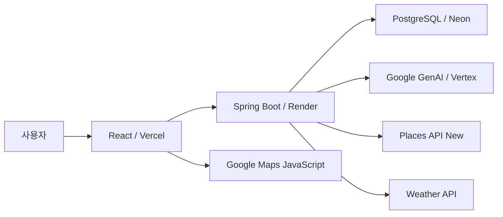
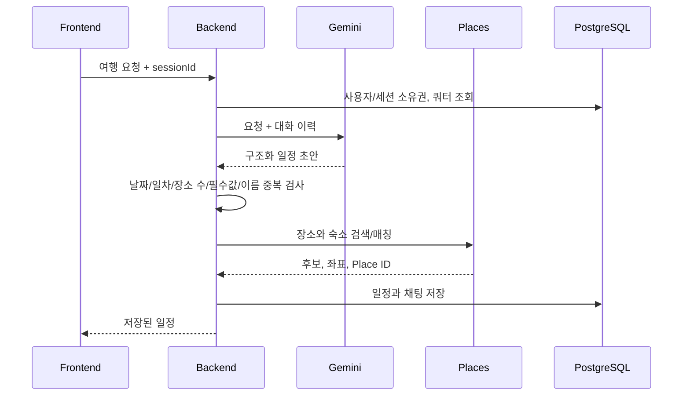

# Compass 아키텍처

2026-11-05 저장소 기준입니다. 아래는 현재 구현이며 이상적인 목표 구조가 아닙니다.

## 서비스 구성

Render가 HTTPS를 제공하며 Caddy는 현재 경로에 없습니다.
Redis 의존성은 남아 있지만 Render 프로필에서 자동 설정을 제외합니다.
대화는 PostgreSQL에 저장하고 Places 검색 캐시는 서버 내 ConcurrentHashMap에 저장합니다.
캐시는 재시작 때 사라지고 여러 인스턴스 사이에 공유되지 않습니다.

## 백엔드 모듈

| 모듈 | 역할 |
| --- | --- |
| global | 공통 응답, 오류 처리, JWT, OAuth2, AI 설정 |
| user | 사용자, 권한, 취향 |
| agent | 채팅, 일정 생성, 품질 검사, Places 검증, 쿼터, 날씨 |
| plan | 일정 저장/조회/수정/삭제 |
| admin | 관리자 권한과 사용자 쿼터 관리 |

## 로그인

1. 프론트에서 백엔드 /oauth2/authorization/google로 이동.
2. Google 인증 후 백엔드 /login/oauth2/code/google로 콜백.
3. 사용자 조회/생성 후 프론트 /oauth2/redirect로 토큰을 포함해 이동.
4. 프론트는 localStorage에 Access/Refresh Token을 저장.
5. Access Token 만료 시 /api/auth/refresh에서 재발급.

Access와 Refresh 타입 검사는 구분되어 있습니다.
Refresh Token의 URL 전달/localStorage 보관과 서버 측 회전·폐기 부재는 개선 대상입니다.

## 일정 생성

현재 요청 전체가 트랜잭션에 포함됩니다. 외부 API 호출과 DB 저장의 분리는 개선 대상입니다.
품질 검사는 Places 매칭 전에 수행하며 방문 시각의 영업 여부나 이동 가능성을 보장하지 않습니다.

## 모델과 검증

- 일반 채팅 기본값: gemini-3.8-flash.
- 일정 생성 기본값: gemini-3.1-pro-preview.
- 일정 모델 호출 실패 시 일반 채팅 모델로 대체 호출.
- 실제 모델은 환경변수로 바뀔 수 있고 공급자 가용성은 별도 확인이 필요합니다.
- Places는 이름/지역/카테고리/평판 점수로 후보를 정렬하고 기준 미만은 불확실로 표시합니다.
- 여러 검색 전략은 현재 순차 실행됩니다. 첫 성공 후 종료하는 최적화는 아직 없습니다.
- 매칭 점수는 정확도 확률이 아닙니다. 지역 불일치를 강제 차단하지 않는 문제도 남아 있습니다.
- 후보 Top3는 생성 응답에 포함되지만 저장 엔티티에는 후보 목록 자체를 저장하지 않습니다.
- 검색 캐시 기본 TTL은 24시간이며 메모리 기반입니다.

## 쿼터

사용자별 당일 저장된 일정 수와 USER 메시지 수를 집계하고 관리자 초기화 baseline을 차감합니다.
별도 원자적 사용량 원장이 아닙니다. 생성 실패로 저장이 롤백되면 집계되지 않는 구조이지,
별도 예약된 쿼터를 환불하는 구현은 아닙니다. 삭제와 동시 요청을 통한 우회는 개선 대상입니다.

## 배포와 CI

GitHub 코드를 Vercel/Render가 빌드합니다. 자동 배포 여부는 각 플랫폼 설정에 따릅니다.
GitHub Actions는 백엔드 테스트, 프론트 lint/build를 수행합니다.
브랜치 보호·배포 게이트는 별도 설정이므로 CI 실패가 자동으로 모든 배포를 막는다고 가정하지 않습니다.

[배포 가이드](RENDER_DEPLOYMENT.md) / [ERD](erd.md)
